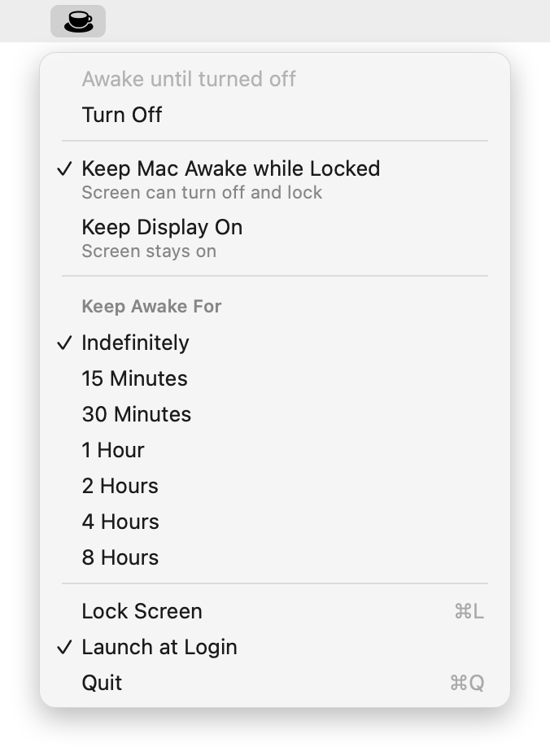

# Vigil

**Keep your AI agents running locally, with your Mac locked.**

Coding agents (Claude Code, Codex, Cursor and friends) run on your Mac. You can drive them from your phone, but only while the Mac is awake. Lock the screen and walk away, and macOS soon puts the Mac to sleep, which stops every agent and drops your remote connection.

Vigil is a tiny menu bar app that fixes exactly that. It keeps the Mac itself awake but lets the display turn off and the screen lock. Anyone sitting at your desk sees only a locked screen, while your agents keep working and stay reachable from your phone.

Most keep-awake apps hold the display on instead, which means you can't lock and leave.

<p align="center"></p>

## Menu

- **Keep Mac Awake while Locked**: the screen can turn off and lock (default).
- **Keep Display On**: the screen stays on too.
- **Keep Awake For**: indefinitely, or 15 minutes to 8 hours. Timed sessions show a countdown next to the icon.
- **Turn Off**, **Lock Screen**, **Launch at Login**

Vigil keeps working on battery too; use **Turn Off** when you don't need it.

One Swift file, no dependencies, no network access.

Want it to keep running with the lid closed and no external display? Run `sudo pmset -a disablesleep 1` (undo with `0`). It runs warmer, so keep the Mac on a hard surface.

## Install

### Ask your agent

Paste this into Claude Code, Codex, Cursor or any coding agent running on your Mac:

```text
Install Vigil (https://github.com/VincentNarbot/Vigil) on this Mac:
1. Check that the Xcode command line tools are installed (xcode-select -p); if not, run xcode-select --install and wait for me.
2. Clone the repo into ~/Developer/Vigil (or update it if it already exists).
3. Read Sources/main.swift and build.sh so you know what you are running, then run ./build.sh.
4. Confirm Vigil is running with: pmset -g assertions | grep Vigil
5. Tell me to open the cup icon in the menu bar and turn on Launch at Login.
```

### Or build it yourself

Requires macOS 14.4+ and the Xcode command line tools.

```sh
git clone https://github.com/VincentNarbot/Vigil.git
cd Vigil
./build.sh
```

This builds `Vigil.app`, ad-hoc signs it, installs it to `~/Applications` and launches it.

## How it works

Vigil holds an IOKit `PreventUserIdleSystemSleep` power assertion (`PreventUserIdleDisplaySleep` with Keep Display On). You can see it with:

```sh
pmset -g assertions | grep Vigil
```

Quitting Vigil releases the assertion immediately.

## License

This app is provided free of use. Use it the way that you want. Enjoy ☕

Released under the [MIT License](LICENSE).
